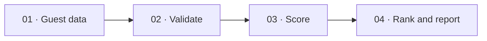

<div align="center">

# 🎄 Who Falls Asleep First?

**A completely unscientific Christmas Day prediction, made reproducible in Python.**


*Six guests. One big lunch. An entirely predictable nap.*

[Get started](#get-started) · [Explore the project](#repository-guide) · [Understand the method](#how-the-prediction-works)

</div>

---

## At a glance

This tiny demonstration asks a deliberately low-stakes question: **who will be
first to fall asleep after Christmas lunch?** A transparent scoring rule ranks
six invented family members using their journey, dinner, age and coffee intake.

> **The prediction: Aunt May.** Her score is **7.61**, narrowly above Grandad's **7.48**.
> These are invented numbers, not a tested statistical model.

| What you need | What you get | What you learn |
| --- | --- | --- |
| Python 3.10+ | A ranked Markdown report | Organised project structure |
| No extra packages | A machine-readable CSV | Repeatable execution |
| Fictional CSV data | A reproducible example | Clear documentation |

## Get started

From the repository root, run these commands in order:

```bash
python 02_scripts/01_validate_data.py
python 02_scripts/02_score_guests.py
python 02_scripts/03_create_report.py
```

**Expected final message**

```text
Predicted Aunt May -> 03_outputs/02_prediction.md
```

Open **[the prediction report](03_outputs/02_prediction.md)** to see the full
ranking, or view the numeric values in
[`03_outputs/01_sleepiness_scores.csv`](03_outputs/01_sleepiness_scores.csv).
The scripts also work when invoked from outside the project directory.

### Check that it worked

```bash
python 05_tests/01_test_pipeline.py
```

This runs the complete example and verifies that Aunt May is the predicted winner.
It requires no external testing library.

## Repository guide

The numbers indicate the intended order of the workflow. Conventional names,
such as `README.md`, `.gitignore` and `LICENSE`, are left unnumbered because
software tools and visitors expect them to use standard names.

```text
.
├── README.md                          ← start here
├── 01_data/
│   ├── 01_christmas_guests.csv         ← original fictional inputs
│   └── 02_validated_guests.csv         ← validated inputs (generated)
├── 02_scripts/
│   ├── 01_validate_data.py             ← check input structure and values
│   ├── 02_score_guests.py              ← calculate sleepiness scores
│   └── 03_create_report.py             ← rank and write report
├── 03_outputs/
│   ├── 01_sleepiness_scores.csv        ← numeric scores
│   └── 02_prediction.md                ← human-readable results
├── 04_docs/
│   └── 01_method.md                    ← data dictionary and assumptions
├── 05_tests/
│   └── 01_test_pipeline.py             ← minimal reproducibility check
├── .gitignore
└── LICENSE
```

## How the prediction works



Each guest is assigned a deliberately arbitrary score:

```text
sleepiness score = 2 × travel hours
                 + 1.5 × dinner portions
                 + 0.02 × age in years
                 − 1.8 × coffees
```

The highest score wins; alphabetical order breaks a tie. For the definitions,
assumptions and caveats, see the **[method notes](04_docs/01_method.md)**.

### Example result

| Rank | Guest | Sleepiness score |
| ---: | --- | ---: |
| 1 | **Aunt May** | **7.61** |
| 2 | Grandad | 7.48 |
| 3 | Uncle Rob | 6.42 |

The complete six-person result is in the [generated report](03_outputs/02_prediction.md).

## Try your own Christmas dinner

1. Edit the six fictional guest records in [`01_data/01_christmas_guests.csv`](01_data/01_christmas_guests.csv).
2. Keep the same five column names and enter nonnegative numeric values.
3. Rerun the three commands in [Get started](#get-started).
4. Compare the updated report with your prediction.

**Privacy:** use imaginary names or obtain permission before publishing real
family members' personal information to a public repository.

## Scope and limitations

- This is a **toy heuristic**, not a machine-learning model or evidence about sleep.
- The data are **invented** and the coefficients are **arbitrary**.
- The result demonstrates a transparent workflow, not predictive accuracy.
- The committed outputs are small examples which can be regenerated; no installation
  environment, API key or external dataset is required.

## Licence

Released under the [MIT Licence](LICENSE). Suitable for reusing as a teaching example.
